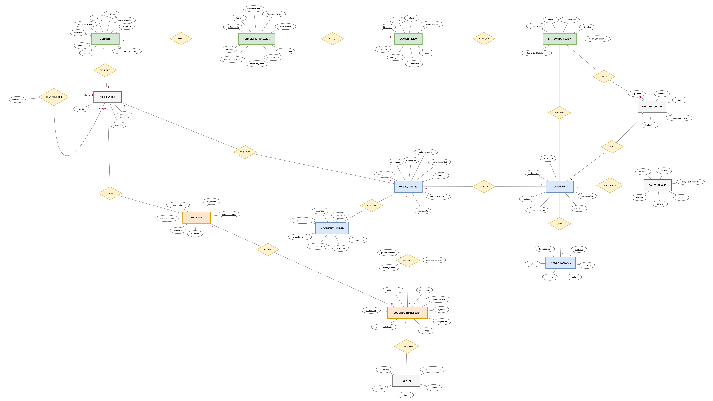
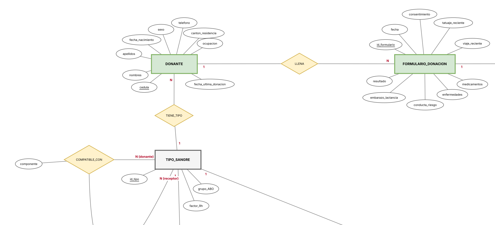
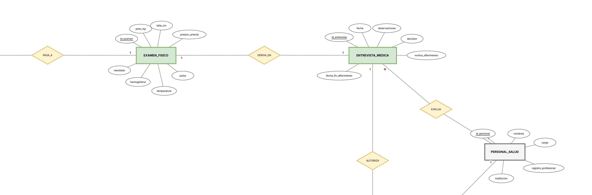
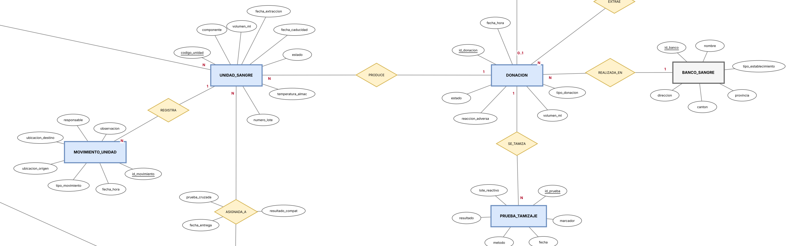
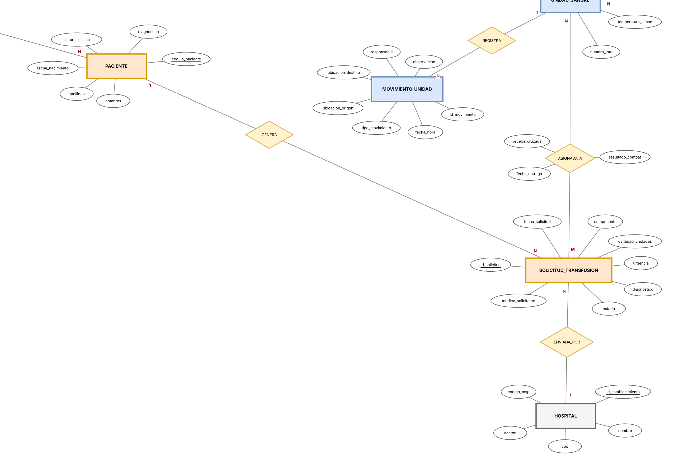
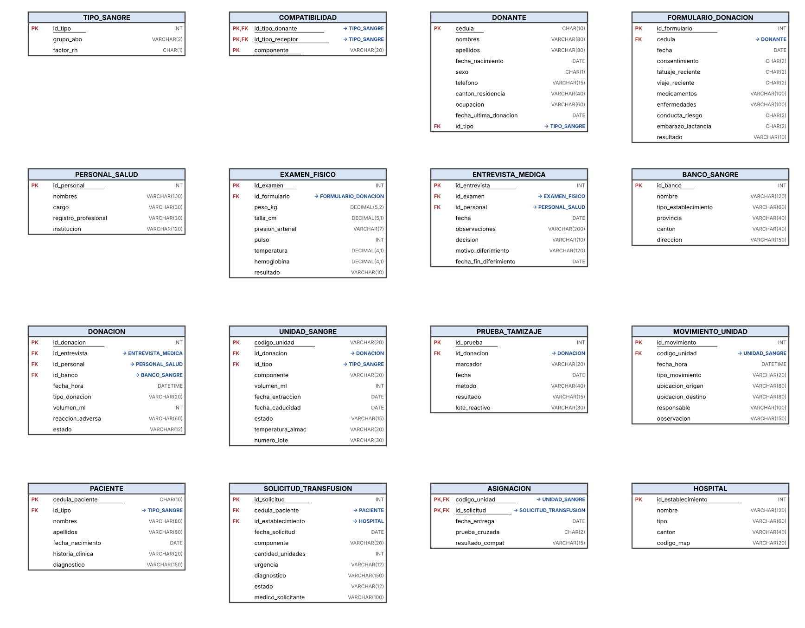

# Banco de Sangre — Gestión de donantes, unidades y transfusiones

**Diseño e implementación de una base de datos relacional para la gestión de un banco de sangre en Loja, Ecuador**

> Informe de fin de unidad — Carrera de Computación, FEIRNNR, Universidad Nacional de Loja

## Datos generales

| Campo | Información |
|---|---|
| Asignatura | Base de datos |
| Ciclo | 3 A |
| Unidad | 1 |
| Resultado de aprendizaje | Modela bases de datos de problemas reales, bajo los principios de solidaridad, transparencia, responsabilidad y honestidad. |
| Docente | Edwin René Guamán Quinche |
| Fecha | 11-11-2026 |
| Nombres y apellidos del estudiante | Darwin Javier Campoverde Navas|

## Contenido del repositorio

| Archivo | Descripción |
|---|---|
| `README.md` | Informe (este documento) |
| `codigo.sql` | Creación de la base de datos y de las 16 tablas (DDL) |
| `InsercionDatos.sql` | Datos de prueba (DML) |
| `consultas.sql` | Las cinco consultas del informe |
| `images/` | Diagramas E-R y relacional, y el archivo editable `.drawio` |

Para reproducirlo en MySQL 8.0.16 o superior, ejecutar en orden: `codigo.sql`, `InsercionDatos.sql` y `consultas.sql`.

## 1. Título

Diseño e implementación de una base de datos para la gestión de un banco de sangre en Loja, Ecuador.

## 2. Contexto del problema

Un banco de sangre es el servicio que capta donantes, extrae y procesa la sangre, comprueba que sea segura y la entrega a los hospitales para transfusiones. En el Ecuador, esta actividad se realiza en establecimientos de la Red Pública y de la Cruz Roja Ecuatoriana, con el Ministerio de Salud Pública (MSP) como ente rector. En Loja, por ejemplo, la Junta Provincial de la Cruz Roja Ecuatoriana y los servicios de medicina transfusional de los hospitales, como el Hospital General Isidro Ayora, cumplen este papel.

El proceso empieza cuando una persona se identifica con su cédula, firma el consentimiento informado y llena el formulario de donación. Luego pasa por un examen físico (peso, presión arterial, pulso, temperatura y hemoglobina) y por una entrevista médica, en la que se decide si es apta, si se difiere su donación o si se rechaza. Solo si es apta se realiza la extracción, de aproximadamente 450 ml. Cada donación se somete a pruebas de tamizaje serológico, se fracciona en componentes (glóbulos rojos, plasma, plaquetas), se almacena y finalmente se asigna a un paciente que fue solicitado por un hospital. Cada paso debe quedar registrado para poder rastrear una unidad desde el donante hasta el paciente.

**Dificultades actuales sin una base de datos**

- Cuesta saber cuántas unidades hay disponibles de cada tipo de sangre y componente en un momento dado, lo que retrasa la respuesta a una solicitud urgente.
- Las unidades tienen fecha de caducidad corta (los glóbulos rojos y las plaquetas caducan en semanas o días). Sin un registro centralizado, se pierden unidades por vencimiento que pudieron haberse usado.
- Los resultados del formulario, del examen físico y de la entrevista se dispersan en papeles. Es difícil comprobar si un donante cumple el intervalo mínimo entre donaciones o si sigue diferido.
- Si un tamizaje sale reactivo, no es fácil identificar con rapidez todas las unidades que salieron de esa donación para descartarlas.
- La compatibilidad entre el tipo de sangre del donante y el del receptor se verifica a mano, con riesgo de error, y la trazabilidad completa (donante → unidad → movimientos → paciente) no queda bien documentada.

> **Nota:** el modelo es de nivel académico. Los criterios de aptitud, los umbrales y los marcadores de tamizaje son referenciales y deben verificarse con la norma vigente del MSP antes de cualquier uso real.

## 3. Objetivos

### 3.1. Objetivo general

Diseñar e implementar una base de datos relacional para la gestión de un banco de sangre, con la finalidad de organizar y centralizar la información de los donantes, las donaciones, las unidades de sangre, el tamizaje, las solicitudes de transfusión de los hospitales y la trazabilidad de cada unidad.

### 3.2. Objetivos específicos

1. Elaborar el diagrama Entidad-Relación en notación de Chen y transformarlo en el modelo relacional, identificando las entidades con sus atributos, relaciones, cardinalidades y claves primarias y foráneas, de forma que representen fielmente el proceso de donación y transfusión.
2. Construir el esquema físico de la base de datos con sentencias SQL DDL y DML, creando las tablas con sus restricciones e insertando datos de prueba coherentes.
3. Verificar el funcionamiento de la base de datos mediante consultas formuladas en álgebra relacional y traducidas a SQL, que permitan controlar la caducidad del inventario, buscar unidades compatibles con un paciente, revisar el tamizaje y resumir el inventario por tipo de sangre.

## 4. Modelos conceptuales de bases de datos

### 4.1. Modelo Entidad-Relación (E-R)

El modelo se elaboró en notación de Chen: los rectángulos representan las entidades, los óvalos los atributos (el atributo subrayado es la clave), los rombos las relaciones y los números 1, N, M y 0..1 las cardinalidades. Se identificaron 14 entidades y 17 relaciones. Los colores agrupan el proceso: verde para el ingreso del donante, azul para la donación y el inventario, naranja para la solicitud y la transfusión, y gris para los catálogos y el personal.



*Figura 1. Diagrama Entidad-Relación completo del banco de sangre (notación de Chen). El archivo editable es [`images/banco_sangre_ecuador_chen.drawio`](images/banco_sangre_ecuador_chen.drawio).*



*Figura 2. Zona de ingreso del donante: donante, tipo de sangre, formulario de donación y compatibilidad.*



*Figura 3. Zona de evaluación: examen físico, entrevista médica, personal de salud y autorización de la donación.*



*Figura 4. Zona de donación e inventario: donación, banco de sangre, unidades, tamizaje y asignación a solicitudes.*



*Figura 5. Zona de solicitud y trazabilidad: paciente, solicitud de transfusión, hospital y movimientos de la unidad.*

**Entidades y atributos**

| Entidad | Atributos |
|---|---|
| `DONANTE` | cedula (clave), nombres, apellidos, fecha_nacimiento, sexo, telefono, canton_residencia, ocupacion, fecha_ultima_donacion |
| `FORMULARIO_DONACION` | id_formulario (clave), fecha, consentimiento, tatuaje_reciente, viaje_reciente, medicamentos, enfermedades, conducta_riesgo, embarazo_lactancia, resultado |
| `EXAMEN_FISICO` | id_examen (clave), peso_kg, talla_cm, presion_arterial, pulso, temperatura, hemoglobina, resultado |
| `ENTREVISTA_MEDICA` | id_entrevista (clave), fecha, observaciones, decision, motivo_diferimiento, fecha_fin_diferimiento |
| `PERSONAL_SALUD` | id_personal (clave), nombres, cargo, registro_profesional, institucion |
| `DONACION` | id_donacion (clave), fecha_hora, tipo_donacion, volumen_ml, reaccion_adversa, estado |
| `BANCO_SANGRE` | id_banco (clave), nombre, tipo_establecimiento, provincia, canton, direccion |
| `UNIDAD_SANGRE` | codigo_unidad (clave), componente, volumen_ml, fecha_extraccion, fecha_caducidad, estado, temperatura_almac, numero_lote |
| `PRUEBA_TAMIZAJE` | id_prueba (clave), marcador, fecha, metodo, resultado, lote_reactivo |
| `TIPO_SANGRE` | id_tipo (clave), grupo_ABO, factor_Rh |
| `PACIENTE` | cedula_paciente (clave), nombres, apellidos, fecha_nacimiento, historia_clinica, diagnostico |
| `SOLICITUD_TRANSFUSION` | id_solicitud (clave), fecha_solicitud, componente, cantidad_unidades, urgencia, diagnostico, estado, medico_solicitante |
| `HOSPITAL` | id_establecimiento (clave), nombre, tipo, canton, codigo_msp |
| `MOVIMIENTO_UNIDAD` | id_movimiento (clave), fecha_hora, tipo_movimiento, ubicacion_origen, ubicacion_destino, responsable, observacion |

**Relaciones y cardinalidades**

| Relación | Entidades y cardinalidad | Descripción |
|---|---|---|
| `LLENA` | DONANTE (1) – FORMULARIO_DONACION (N) | Un donante llena un formulario cada vez que intenta donar. |
| `PASA_A` | FORMULARIO_DONACION (1) – EXAMEN_FISICO (1) | Un formulario apto pasa a un examen físico. |
| `DERIVA_EN` | EXAMEN_FISICO (1) – ENTREVISTA_MEDICA (1) | El examen físico deriva en una entrevista médica. |
| `EVALUA` | PERSONAL_SALUD (1) – ENTREVISTA_MEDICA (N) | Un profesional evalúa muchas entrevistas. |
| `AUTORIZA` | ENTREVISTA_MEDICA (1) – DONACION (0..1) | Una entrevista apta autoriza como máximo una donación; si es diferida o rechazada no hay donación. |
| `EXTRAE` | PERSONAL_SALUD (1) – DONACION (N) | Un profesional realiza muchas extracciones. |
| `REALIZADA_EN` | BANCO_SANGRE (1) – DONACION (N) | Cada donación se realiza en un banco de sangre. |
| `PRODUCE` | DONACION (1) – UNIDAD_SANGRE (N) | Una donación se fracciona en varias unidades (componentes). |
| `SE_TAMIZA` | DONACION (1) – PRUEBA_TAMIZAJE (N) | Cada donación se somete a varias pruebas, una por marcador. |
| `TIENE_TIPO (donante)` | TIPO_SANGRE (1) – DONANTE (N) | Cada donante tiene un tipo de sangre. |
| `ES_DE_TIPO` | TIPO_SANGRE (1) – UNIDAD_SANGRE (N) | Cada unidad es de un tipo de sangre. |
| `TIENE_TIPO (paciente)` | TIPO_SANGRE (1) – PACIENTE (N) | Cada paciente tiene un tipo de sangre. |
| `COMPATIBLE_CON` | TIPO_SANGRE (N) – TIPO_SANGRE (M) | Relación reflexiva muchos a muchos entre tipo del donante y tipo del receptor, con el atributo componente. |
| `ASIGNADA_A` | UNIDAD_SANGRE (N) – SOLICITUD_TRANSFUSION (M) | Relación muchos a muchos con los atributos fecha_entrega, prueba_cruzada y resultado_compat. |
| `GENERA` | PACIENTE (1) – SOLICITUD_TRANSFUSION (N) | Un paciente puede tener varias solicitudes. |
| `ENVIADA_POR` | HOSPITAL (1) – SOLICITUD_TRANSFUSION (N) | Cada solicitud la envía un hospital. |
| `REGISTRA` | UNIDAD_SANGRE (1) – MOVIMIENTO_UNIDAD (N) | Cada unidad acumula movimientos que dan la trazabilidad. |

### 4.2. Modelo relacional

El modelo E-R se transformó al relacional con las reglas habituales: cada entidad pasa a ser una relación (tabla) con su clave primaria; en las relaciones 1:N la clave foránea se coloca en el lado N; en las relaciones 1:1 la clave foránea se coloca en la tabla dependiente y se declara `UNIQUE`; y cada relación M:N se convierte en una relación nueva con clave primaria compuesta. Así, `COMPATIBLE_CON` dio origen a `COMPATIBILIDAD` y `ASIGNADA_A` dio origen a `ASIGNACION`, por lo que el modelo relacional tiene 16 relaciones.



*Figura 6. Diagrama relacional (cuadros). Las claves foráneas indican la tabla a la que apuntan.*

| Relación | Clave primaria | Claves foráneas | Otros atributos |
|---|---|---|---|
| `TIPO_SANGRE` | <u>id_tipo</u> | — | [('grupo_abo, factor_rh', '')] |
| `COMPATIBILIDAD` | <u>id_tipo_donante, id_tipo_receptor, componente</u> | id_tipo_donante → TIPO_SANGRE; id_tipo_receptor → TIPO_SANGRE | — |
| `BANCO_SANGRE` | <u>id_banco</u> | — | nombre, tipo_establecimiento, provincia, canton, direccion |
| `HOSPITAL` | <u>id_establecimiento</u> | — | nombre, tipo, canton, codigo_msp |
| `PERSONAL_SALUD` | <u>id_personal</u> | — | nombres, cargo, registro_profesional, institucion |
| `DONANTE` | <u>cedula</u> | id_tipo → TIPO_SANGRE | nombres, apellidos, fecha_nacimiento, sexo, telefono, canton_residencia, ocupacion, fecha_ultima_donacion |
| `FORMULARIO_DONACION` | <u>id_formulario</u> | cedula → DONANTE | fecha, consentimiento, tatuaje_reciente, viaje_reciente, medicamentos, enfermedades, conducta_riesgo, embarazo_lactancia, resultado |
| `EXAMEN_FISICO` | <u>id_examen</u> | id_formulario → FORMULARIO_DONACION (UNIQUE) | peso_kg, talla_cm, presion_arterial, pulso, temperatura, hemoglobina, resultado |
| `ENTREVISTA_MEDICA` | <u>id_entrevista</u> | id_examen → EXAMEN_FISICO (UNIQUE); id_personal → PERSONAL_SALUD | fecha, observaciones, decision, motivo_diferimiento, fecha_fin_diferimiento |
| `DONACION` | <u>id_donacion</u> | id_entrevista → ENTREVISTA_MEDICA (UNIQUE); id_personal → PERSONAL_SALUD; id_banco → BANCO_SANGRE | fecha_hora, tipo_donacion, volumen_ml, reaccion_adversa, estado |
| `UNIDAD_SANGRE` | <u>codigo_unidad</u> | id_donacion → DONACION; id_tipo → TIPO_SANGRE | componente, volumen_ml, fecha_extraccion, fecha_caducidad, estado, temperatura_almac, numero_lote |
| `PRUEBA_TAMIZAJE` | <u>id_prueba</u> | id_donacion → DONACION | marcador, fecha, metodo, resultado, lote_reactivo |
| `PACIENTE` | <u>cedula_paciente</u> | id_tipo → TIPO_SANGRE | nombres, apellidos, fecha_nacimiento, historia_clinica, diagnostico |
| `SOLICITUD_TRANSFUSION` | <u>id_solicitud</u> | cedula_paciente → PACIENTE; id_establecimiento → HOSPITAL | fecha_solicitud, componente, cantidad_unidades, urgencia, diagnostico, estado, medico_solicitante |
| `ASIGNACION` | <u>codigo_unidad, id_solicitud</u> | codigo_unidad → UNIDAD_SANGRE; id_solicitud → SOLICITUD_TRANSFUSION | fecha_entrega, prueba_cruzada, resultado_compat |
| `MOVIMIENTO_UNIDAD` | <u>id_movimiento</u> | codigo_unidad → UNIDAD_SANGRE | fecha_hora, tipo_movimiento, ubicacion_origen, ubicacion_destino, responsable, observacion |

## 5. Código SQL

Los archivos completos están en [`codigo.sql`](codigo.sql) e [`InsercionDatos.sql`](InsercionDatos.sql). Los datos de prueba son ficticios: las cédulas, los nombres, los códigos del MSP y las direcciones no corresponden a personas ni a registros reales.

### 5.1. Creación de tablas (DDL)

El informe presenta las siguientes sentencias de creación de tablas:

**Tabla `TIPO_SANGRE`:**

```sql
CREATE TABLE TIPO_SANGRE (
    id_tipo     INT         NOT NULL AUTO_INCREMENT,
    grupo_abo   VARCHAR(2)  NOT NULL,
    factor_rh   CHAR(1)     NOT NULL,
    PRIMARY KEY (id_tipo),
    CONSTRAINT uq_tipo_sangre UNIQUE (grupo_abo, factor_rh),
    CONSTRAINT ck_tipo_grupo  CHECK (grupo_abo IN ('O', 'A', 'B', 'AB')),
    CONSTRAINT ck_tipo_rh     CHECK (factor_rh IN ('+', '-'))
);
```

**Tabla `COMPATIBILIDAD`:**

```sql
CREATE TABLE COMPATIBILIDAD (
    id_tipo_donante   INT         NOT NULL,
    id_tipo_receptor  INT         NOT NULL,
    componente        VARCHAR(20) NOT NULL,
    PRIMARY KEY (id_tipo_donante, id_tipo_receptor, componente),
    CONSTRAINT ck_compat_componente CHECK (componente IN ('CGR', 'PLASMA',
                                                          'PLAQUETAS')),
    CONSTRAINT fk_compat_donante  FOREIGN KEY (id_tipo_donante)
        REFERENCES TIPO_SANGRE (id_tipo),
    CONSTRAINT fk_compat_receptor FOREIGN KEY (id_tipo_receptor)
        REFERENCES TIPO_SANGRE (id_tipo)
);
```

**Tabla `BANCO_SANGRE`:**

```sql
CREATE TABLE BANCO_SANGRE (
    id_banco              INT          NOT NULL AUTO_INCREMENT,
    nombre                VARCHAR(120) NOT NULL,
    tipo_establecimiento  VARCHAR(60)  NOT NULL,
    provincia             VARCHAR(40)  NOT NULL,
    canton                VARCHAR(40)  NOT NULL,
    direccion             VARCHAR(150),
    PRIMARY KEY (id_banco),
    CONSTRAINT uq_banco_nombre UNIQUE (nombre)
);
```

**Tabla `HOSPITAL`:**

```sql
CREATE TABLE HOSPITAL (
    id_establecimiento  INT          NOT NULL AUTO_INCREMENT,
    nombre              VARCHAR(120) NOT NULL,
    tipo                VARCHAR(60)  NOT NULL,
    canton              VARCHAR(40)  NOT NULL,
    codigo_msp          VARCHAR(20),
    PRIMARY KEY (id_establecimiento),
    CONSTRAINT uq_hospital_nombre UNIQUE (nombre),
    CONSTRAINT uq_hospital_codigo UNIQUE (codigo_msp)
);
```

**Tabla `PERSONAL_SALUD`:**

```sql
CREATE TABLE PERSONAL_SALUD (
    id_personal          INT          NOT NULL AUTO_INCREMENT,
    nombres              VARCHAR(100) NOT NULL,
    cargo                VARCHAR(30)  NOT NULL,
    registro_profesional VARCHAR(30),
    institucion          VARCHAR(120),
    PRIMARY KEY (id_personal),
    CONSTRAINT uq_personal_registro UNIQUE (registro_profesional),
    CONSTRAINT ck_personal_cargo    CHECK (cargo IN ('MEDICO', 'ENFERMERIA',
                                                     'LABORATORIO'))
);
```

**Tabla `DONANTE`:**

```sql
CREATE TABLE DONANTE (
    cedula                 CHAR(10)     NOT NULL,
    nombres                VARCHAR(80)  NOT NULL,
    apellidos              VARCHAR(80)  NOT NULL,
    fecha_nacimiento       DATE         NOT NULL,
    sexo                   CHAR(1)      NOT NULL,
    telefono               VARCHAR(15),
    canton_residencia      VARCHAR(40),
    ocupacion              VARCHAR(60),
    fecha_ultima_donacion  DATE,
    id_tipo                INT          NOT NULL,
    PRIMARY KEY (cedula),
    CONSTRAINT ck_donante_sexo   CHECK (sexo IN ('M', 'F')),
    CONSTRAINT ck_donante_ultima CHECK (fecha_ultima_donacion IS NULL
                                        OR fecha_ultima_donacion > fecha_nacimiento),
    CONSTRAINT fk_donante_tipo   FOREIGN KEY (id_tipo)
        REFERENCES TIPO_SANGRE (id_tipo)
);
```

**Tabla `FORMULARIO_DONACION`:**

```sql
CREATE TABLE FORMULARIO_DONACION (
    id_formulario       INT          NOT NULL AUTO_INCREMENT,
    cedula              CHAR(10)     NOT NULL,
    fecha               DATE         NOT NULL,
    consentimiento      CHAR(2)      NOT NULL,
    tatuaje_reciente    CHAR(2)      NOT NULL,
    viaje_reciente      CHAR(2)      NOT NULL,
    medicamentos        VARCHAR(100),
    enfermedades        VARCHAR(100),
    conducta_riesgo     CHAR(2)      NOT NULL,
    embarazo_lactancia  CHAR(2)      NOT NULL DEFAULT 'NO',
    resultado           VARCHAR(10)  NOT NULL,
    PRIMARY KEY (id_formulario),
    CONSTRAINT ck_form_consent   CHECK (consentimiento IN ('SI', 'NO')),
    CONSTRAINT ck_form_tatuaje   CHECK (tatuaje_reciente IN ('SI', 'NO')),
    CONSTRAINT ck_form_viaje     CHECK (viaje_reciente IN ('SI', 'NO')),
    CONSTRAINT ck_form_conducta  CHECK (conducta_riesgo IN ('SI', 'NO')),
    CONSTRAINT ck_form_embarazo  CHECK (embarazo_lactancia IN ('SI', 'NO')),
    CONSTRAINT ck_form_resultado CHECK (resultado IN ('APTO', 'NO_APTO')),
    CONSTRAINT fk_form_donante   FOREIGN KEY (cedula)
        REFERENCES DONANTE (cedula)
);
```

**Tabla `EXAMEN_FISICO`:**

```sql
CREATE TABLE EXAMEN_FISICO (
    id_examen         INT           NOT NULL AUTO_INCREMENT,
    id_formulario     INT           NOT NULL,
    peso_kg           DECIMAL(5,2)  NOT NULL,
    talla_cm          DECIMAL(5,1),
    presion_arterial  VARCHAR(7)    NOT NULL,
    pulso             INT           NOT NULL,
    temperatura       DECIMAL(4,1)  NOT NULL,
    hemoglobina       DECIMAL(4,1)  NOT NULL,
    resultado         VARCHAR(10)   NOT NULL,
    PRIMARY KEY (id_examen),
    CONSTRAINT uq_examen_formulario UNIQUE (id_formulario),
    CONSTRAINT ck_examen_peso       CHECK (peso_kg > 0 AND peso_kg < 300),
    CONSTRAINT ck_examen_pulso      CHECK (pulso BETWEEN 30 AND 220),
    CONSTRAINT ck_examen_temp       CHECK (temperatura BETWEEN 30 AND 45),
    CONSTRAINT ck_examen_hb         CHECK (hemoglobina > 0 AND hemoglobina < 25),
    CONSTRAINT ck_examen_resultado  CHECK (resultado IN ('APTO', 'NO_APTO')),
    CONSTRAINT fk_examen_formulario FOREIGN KEY (id_formulario)
        REFERENCES FORMULARIO_DONACION (id_formulario)
);
```

**Tabla `ENTREVISTA_MEDICA`:**

```sql
CREATE TABLE ENTREVISTA_MEDICA (
    id_entrevista           INT          NOT NULL AUTO_INCREMENT,
    id_examen               INT          NOT NULL,
    id_personal             INT          NOT NULL,
    fecha                   DATE         NOT NULL,
    observaciones           VARCHAR(200),
    decision                VARCHAR(10)  NOT NULL,
    motivo_diferimiento     VARCHAR(120),
    fecha_fin_diferimiento  DATE,
    PRIMARY KEY (id_entrevista),
    CONSTRAINT uq_entrevista_examen UNIQUE (id_examen),
    CONSTRAINT ck_entrevista_decision CHECK (decision IN ('APTO', 'DIFERIDO',
                                                          'RECHAZADO')),
    CONSTRAINT ck_entrevista_dif CHECK (
        (decision = 'DIFERIDO' AND fecha_fin_diferimiento IS NOT NULL)
        OR (decision <> 'DIFERIDO' AND fecha_fin_diferimiento IS NULL)),
    CONSTRAINT fk_entrevista_examen   FOREIGN KEY (id_examen)
        REFERENCES EXAMEN_FISICO (id_examen),
    CONSTRAINT fk_entrevista_personal FOREIGN KEY (id_personal)
        REFERENCES PERSONAL_SALUD (id_personal)
);
```

**Tabla `DONACION`:**

```sql
CREATE TABLE DONACION (
    id_donacion       INT          NOT NULL AUTO_INCREMENT,
    id_entrevista     INT          NOT NULL,
    id_personal       INT          NOT NULL,
    id_banco          INT          NOT NULL,
    fecha_hora        DATETIME     NOT NULL,
    tipo_donacion     VARCHAR(20)  NOT NULL DEFAULT 'SANGRE_TOTAL',
    volumen_ml        INT          NOT NULL,
    reaccion_adversa  VARCHAR(60)  NOT NULL DEFAULT 'NINGUNA',
    estado            VARCHAR(12)  NOT NULL DEFAULT 'COMPLETA',
    PRIMARY KEY (id_donacion),
    CONSTRAINT uq_donacion_entrevista UNIQUE (id_entrevista),
    CONSTRAINT ck_donacion_tipo   CHECK (tipo_donacion IN ('SANGRE_TOTAL',
                                                          'AFERESIS')),
    CONSTRAINT ck_donacion_vol    CHECK (volumen_ml > 0 AND volumen_ml <= 600),
    CONSTRAINT ck_donacion_estado CHECK (estado IN ('COMPLETA', 'INCOMPLETA')),
    CONSTRAINT fk_donacion_entrevista FOREIGN KEY (id_entrevista)
        REFERENCES ENTREVISTA_MEDICA (id_entrevista),
    CONSTRAINT fk_donacion_personal   FOREIGN KEY (id_personal)
        REFERENCES PERSONAL_SALUD (id_personal),
    CONSTRAINT fk_donacion_banco      FOREIGN KEY (id_banco)
        REFERENCES BANCO_SANGRE (id_banco)
);
```

**Tabla `UNIDAD_SANGRE`:**

```sql
CREATE TABLE UNIDAD_SANGRE (
    codigo_unidad      VARCHAR(20)  NOT NULL,
    id_donacion        INT          NOT NULL,
    id_tipo            INT          NOT NULL,
    componente         VARCHAR(20)  NOT NULL,
    volumen_ml         INT          NOT NULL,
    fecha_extraccion   DATE         NOT NULL,
    fecha_caducidad    DATE         NOT NULL,
    estado             VARCHAR(15)  NOT NULL DEFAULT 'CUARENTENA',
    temperatura_almac  VARCHAR(20),
    numero_lote        VARCHAR(30),
    PRIMARY KEY (codigo_unidad),
    CONSTRAINT ck_unidad_componente CHECK (componente IN ('SANGRE_TOTAL', 'CGR',
                                                         'PLASMA', 'PLAQUETAS')),
    CONSTRAINT ck_unidad_volumen    CHECK (volumen_ml > 0),
    CONSTRAINT ck_unidad_fechas     CHECK (fecha_caducidad > fecha_extraccion),
    CONSTRAINT ck_unidad_estado     CHECK (estado IN ('CUARENTENA', 'DISPONIBLE',
                                        'RESERVADA', 'TRANSFUNDIDA',
                                        'DESCARTADA', 'CADUCADA')),
    CONSTRAINT fk_unidad_donacion FOREIGN KEY (id_donacion)
        REFERENCES DONACION (id_donacion),
    CONSTRAINT fk_unidad_tipo     FOREIGN KEY (id_tipo)
        REFERENCES TIPO_SANGRE (id_tipo)
);
```

**Tabla `PRUEBA_TAMIZAJE`:**

```sql
CREATE TABLE PRUEBA_TAMIZAJE (
    id_prueba      INT          NOT NULL AUTO_INCREMENT,
    id_donacion    INT          NOT NULL,
    marcador       VARCHAR(20)  NOT NULL,
    fecha          DATE         NOT NULL,
    metodo         VARCHAR(40),
    resultado      VARCHAR(15)  NOT NULL,
    lote_reactivo  VARCHAR(30),
    PRIMARY KEY (id_prueba),
    CONSTRAINT uq_prueba_marcador  UNIQUE (id_donacion, marcador),
    CONSTRAINT ck_prueba_marcador  CHECK (marcador IN ('VIH', 'HEPATITIS_B',
                                         'HEPATITIS_C', 'SIFILIS', 'CHAGAS',
                                         'HTLV')),
    CONSTRAINT ck_prueba_resultado CHECK (resultado IN ('REACTIVO',
                                                        'NO_REACTIVO')),
    CONSTRAINT fk_prueba_donacion  FOREIGN KEY (id_donacion)
        REFERENCES DONACION (id_donacion)
);
```

**Tabla `PACIENTE`:**

```sql
CREATE TABLE PACIENTE (
    cedula_paciente   CHAR(10)     NOT NULL,
    id_tipo           INT          NOT NULL,
    nombres           VARCHAR(80)  NOT NULL,
    apellidos         VARCHAR(80)  NOT NULL,
    fecha_nacimiento  DATE         NOT NULL,
    historia_clinica  VARCHAR(20),
    diagnostico       VARCHAR(150),
    PRIMARY KEY (cedula_paciente),
    CONSTRAINT uq_paciente_historia UNIQUE (historia_clinica),
    CONSTRAINT fk_paciente_tipo     FOREIGN KEY (id_tipo)
        REFERENCES TIPO_SANGRE (id_tipo)
);
```

**Tabla `SOLICITUD_TRANSFUSION`:**

```sql
CREATE TABLE SOLICITUD_TRANSFUSION (
    id_solicitud        INT          NOT NULL AUTO_INCREMENT,
    cedula_paciente     CHAR(10)     NOT NULL,
    id_establecimiento  INT          NOT NULL,
    fecha_solicitud     DATE         NOT NULL,
    componente          VARCHAR(20)  NOT NULL,
    cantidad_unidades   INT          NOT NULL,
    urgencia            VARCHAR(12)  NOT NULL DEFAULT 'RUTINA',
    diagnostico         VARCHAR(150),
    estado              VARCHAR(12)  NOT NULL DEFAULT 'PENDIENTE',
    medico_solicitante  VARCHAR(100) NOT NULL,
    PRIMARY KEY (id_solicitud),
    CONSTRAINT ck_sol_componente CHECK (componente IN ('SANGRE_TOTAL', 'CGR',
                                                      'PLASMA', 'PLAQUETAS')),
    CONSTRAINT ck_sol_cantidad   CHECK (cantidad_unidades > 0),
    CONSTRAINT ck_sol_urgencia   CHECK (urgencia IN ('RUTINA', 'URGENTE',
                                                    'EMERGENCIA')),
    CONSTRAINT ck_sol_estado     CHECK (estado IN ('PENDIENTE', 'ATENDIDA',
                                                  'CANCELADA')),
    CONSTRAINT fk_sol_paciente   FOREIGN KEY (cedula_paciente)
        REFERENCES PACIENTE (cedula_paciente),
    CONSTRAINT fk_sol_hospital   FOREIGN KEY (id_establecimiento)
        REFERENCES HOSPITAL (id_establecimiento)
);
```

**Tabla `ASIGNACION`:**

```sql
CREATE TABLE ASIGNACION (
    codigo_unidad    VARCHAR(20)  NOT NULL,
    id_solicitud     INT          NOT NULL,
    fecha_entrega    DATE,
    prueba_cruzada   CHAR(2)      NOT NULL,
    resultado_compat VARCHAR(15)  NOT NULL,
    PRIMARY KEY (codigo_unidad, id_solicitud),
    CONSTRAINT ck_asig_prueba    CHECK (prueba_cruzada IN ('SI', 'NO')),
    CONSTRAINT ck_asig_resultado CHECK (resultado_compat IN ('COMPATIBLE',
                                                             'INCOMPATIBLE')),
    CONSTRAINT fk_asig_unidad    FOREIGN KEY (codigo_unidad)
        REFERENCES UNIDAD_SANGRE (codigo_unidad),
    CONSTRAINT fk_asig_solicitud FOREIGN KEY (id_solicitud)
        REFERENCES SOLICITUD_TRANSFUSION (id_solicitud)
);
```

**Tabla `MOVIMIENTO_UNIDAD`:**

```sql
CREATE TABLE MOVIMIENTO_UNIDAD (
    id_movimiento      INT          NOT NULL AUTO_INCREMENT,
    codigo_unidad      VARCHAR(20)  NOT NULL,
    fecha_hora         DATETIME     NOT NULL,
    tipo_movimiento    VARCHAR(20)  NOT NULL,
    ubicacion_origen   VARCHAR(80),
    ubicacion_destino  VARCHAR(80),
    responsable        VARCHAR(100) NOT NULL,
    observacion        VARCHAR(150),
    PRIMARY KEY (id_movimiento),
    CONSTRAINT ck_mov_tipo CHECK (tipo_movimiento IN ('INGRESO',
                                  'ALMACENAMIENTO', 'DESPACHO', 'TRANSFUSION',
                                  'DESCARTE')),
    CONSTRAINT fk_mov_unidad FOREIGN KEY (codigo_unidad)
        REFERENCES UNIDAD_SANGRE (codigo_unidad)
);
```

### 5.2. Inserción de datos (DML)

Datos de prueba (archivo completo en [`InsercionDatos.sql`](InsercionDatos.sql)):

```sql
INSERT INTO TIPO_SANGRE (id_tipo, grupo_abo, factor_rh) VALUES
    (1, 'O', '+'),
    (2, 'O', '-'),
    (3, 'A', '+'),
    (4, 'A', '-'),
    (5, 'B', '+'),
    (6, 'B', '-'),
    (7, 'AB', '+'),
    (8, 'AB', '-');

-- Compatibilidad de glóbulos rojos (CGR): donante -> receptor
INSERT INTO COMPATIBILIDAD (id_tipo_donante, id_tipo_receptor, componente) VALUES
    (1,1,'CGR'), (1,3,'CGR'), (1,5,'CGR'), (1,7,'CGR'), (2,1,'CGR'),
    (2,2,'CGR'), (2,3,'CGR'), (2,4,'CGR'), (2,5,'CGR'), (2,6,'CGR'),
    (2,7,'CGR'), (2,8,'CGR'), (3,3,'CGR'), (3,7,'CGR'), (4,3,'CGR'),
    (4,4,'CGR'), (4,7,'CGR'), (4,8,'CGR'), (5,5,'CGR'), (5,7,'CGR'),
    (6,5,'CGR'), (6,6,'CGR'), (6,7,'CGR'), (6,8,'CGR'), (7,7,'CGR'),
    (8,7,'CGR'), (8,8,'CGR');

INSERT INTO BANCO_SANGRE (id_banco, nombre, tipo_establecimiento, provincia,
                          canton, direccion) VALUES
    (1, 'Cruz Roja Ecuatoriana - Junta Provincial de Loja',
        'Banco de sangre', 'Loja', 'Loja', 'Loja (dato de prueba)'),
    (2, 'Servicio de Medicina Transfusional - Hospital General Isidro Ayora',
        'Servicio de medicina transfusional', 'Loja', 'Loja',
        'Loja (dato de prueba)');

INSERT INTO HOSPITAL (id_establecimiento, nombre, tipo, canton,
                      codigo_msp) VALUES
    (1, 'Hospital General Isidro Ayora', 'Hospital general', 'Loja', 'MSP-0001'),
    (2, 'Hospital Basico de Catamayo'  , 'Hospital basico' , 'Catamayo',
        'MSP-0002');

INSERT INTO PERSONAL_SALUD (id_personal, nombres, cargo, registro_profesional,
                            institucion) VALUES
    (1, 'Maria Elena Ortiz'   , 'MEDICO'     , 'REG-1001',
        'Cruz Roja Ecuatoriana - Loja'),
    (2, 'Carlos Andrade'      , 'ENFERMERIA' , 'REG-1002',
        'Cruz Roja Ecuatoriana - Loja'),
    (3, 'Luis Romero'         , 'MEDICO'     , 'REG-1003',
        'Hospital General Isidro Ayora'),
    (4, 'Patricia Jaramillo'  , 'ENFERMERIA' , 'REG-1004',
        'Hospital General Isidro Ayora');

-- Datos ficticios: las cedulas y los nombres no corresponden a personas reales
INSERT INTO DONANTE (cedula, nombres, apellidos, fecha_nacimiento, sexo,
                     telefono, canton_residencia, ocupacion,
                     fecha_ultima_donacion, id_tipo) VALUES
    ('1100000001', 'Juan Carlos' , 'Armijos Leon'  , '1998-03-14', 'M',
     '0990000001', 'Loja'    , 'Estudiante'  , '2026-10-20', 1),
    ('1100000002', 'Luisa Fernanda', 'Castillo Pardo', '1995-07-02', 'F',
     '0990000002', 'Loja'    , 'Docente'     , '2026-09-12', 3),
    ('1100000003', 'Diego Paul'  , 'Jimenez Torres', '1990-11-23', 'M',
     '0990000003', 'Catamayo', 'Comerciante' , '2026-10-05', 2),
    ('1100000004', 'Marco Antonio', 'Vega Salinas' , '1988-01-30', 'M',
     '0990000004', 'Loja'    , 'Ingeniero'   , '2026-10-27', 5),
    ('1100000005', 'Ana Belen'   , 'Ruiz Cueva'    , '2000-05-19', 'F',
     '0990000005', 'Loja'    , 'Estudiante'  , NULL        , 6),
    ('1100000006', 'Karla Dayana', 'Sarango Pineda', '1999-09-08', 'F',
     '0990000006', 'Saraguro', 'Estudiante'  , NULL        , 8),
    ('1100000007', 'Jose Luis'   , 'Tapia Merino'  , '1993-12-11', 'M',
     '0990000007', 'Loja'    , 'Contador'    , '2026-11-03', 4),
    ('1100000008', 'Gabriela Alexandra', 'Ochoa Rivera', '1997-04-25', 'F',
     '0990000008', 'Loja'    , 'Enfermera'   , NULL        , 1);

INSERT INTO FORMULARIO_DONACION (id_formulario, cedula, fecha, consentimiento,
        tatuaje_reciente, viaje_reciente, medicamentos, enfermedades,
        conducta_riesgo, embarazo_lactancia, resultado) VALUES
    (1, '1100000001', '2026-06-15', 'SI', 'NO', 'NO', NULL, NULL, 'NO', 'NO', 'APTO'),
    (2, '1100000002', '2026-09-12', 'SI', 'NO', 'NO', NULL, NULL, 'NO', 'NO', 'APTO'),
    (3, '1100000003', '2026-10-05', 'SI', 'NO', 'NO', NULL, NULL, 'NO', 'NO', 'APTO'),
    (4, '1100000001', '2026-10-20', 'SI', 'NO', 'NO', NULL, NULL, 'NO', 'NO', 'APTO'),
    (5, '1100000004', '2026-10-27', 'SI', 'NO', 'NO', NULL, NULL, 'NO', 'NO', 'APTO'),
    (6, '1100000007', '2026-11-03', 'SI', 'NO', 'NO', NULL, NULL, 'NO', 'NO', 'APTO'),
    (7, '1100000005', '2026-11-04', 'SI', 'NO', 'NO', NULL, NULL, 'NO', 'NO', 'APTO'),
    (8, '1100000006', '2026-11-05', 'SI', 'SI', 'NO', NULL, NULL, 'NO', 'NO', 'NO_APTO'),
    (9, '1100000008', '2026-11-06', 'SI', 'NO', 'NO', NULL, NULL, 'NO', 'NO', 'APTO');

INSERT INTO EXAMEN_FISICO (id_examen, id_formulario, peso_kg, talla_cm,
        presion_arterial, pulso, temperatura, hemoglobina, resultado) VALUES
    (1, 1, 72.5, 175.0, '120/80', 72, 36.5, 15.2, 'APTO'),
    (2, 2, 61.0, 162.0, '110/70', 76, 36.6, 13.8, 'APTO'),
    (3, 3, 80.2, 178.0, '125/80', 70, 36.4, 15.0, 'APTO'),
    (4, 4, 72.8, 175.0, '118/78', 74, 36.5, 15.1, 'APTO'),
    (5, 5, 85.0, 180.0, '122/82', 68, 36.7, 15.6, 'APTO'),
    (6, 6, 77.4, 173.0, '115/75', 71, 36.5, 14.9, 'APTO'),
    (7, 7, 55.0, 158.0, '105/68', 80, 36.6, 11.2, 'NO_APTO'),
    (8, 9, 58.5, 160.0, '108/70', 75, 36.5, 13.5, 'APTO');

INSERT INTO ENTREVISTA_MEDICA (id_entrevista, id_examen, id_personal, fecha,
        observaciones, decision, motivo_diferimiento,
        fecha_fin_diferimiento) VALUES
    (1, 1, 1, '2026-06-15', 'Sin hallazgos', 'APTO'    , NULL, NULL),
    (2, 2, 1, '2026-09-12', 'Sin hallazgos', 'APTO'    , NULL, NULL),
    (3, 3, 1, '2026-10-05', 'Sin hallazgos', 'APTO'    , NULL, NULL),
    (4, 4, 1, '2026-10-20', 'Sin hallazgos', 'APTO'    , NULL, NULL),
    (5, 5, 3, '2026-10-27', 'Sin hallazgos', 'APTO'    , NULL, NULL),
    (6, 6, 3, '2026-11-03', 'Sin hallazgos', 'APTO'    , NULL, NULL),
    (7, 7, 1, '2026-11-04', 'Hemoglobina por debajo del minimo', 'DIFERIDO',
        'Hemoglobina baja', '2027-02-04'),
    (8, 8, 1, '2026-11-06', 'Apto; donacion pendiente de agendar', 'APTO',
        NULL, NULL);

INSERT INTO DONACION (id_donacion, id_entrevista, id_personal, id_banco,
        fecha_hora, tipo_donacion, volumen_ml, reaccion_adversa, estado) VALUES
    (1, 1, 2, 1, '2026-06-15 08:40:00', 'SANGRE_TOTAL', 450, 'NINGUNA', 'COMPLETA'),
    (2, 2, 2, 1, '2026-09-12 09:15:00', 'SANGRE_TOTAL', 450, 'NINGUNA', 'COMPLETA'),
    (3, 3, 2, 1, '2026-10-05 10:05:00', 'SANGRE_TOTAL', 450, 'NINGUNA', 'COMPLETA'),
    (4, 4, 2, 1, '2026-10-20 08:30:00', 'SANGRE_TOTAL', 450, 'NINGUNA', 'COMPLETA'),
    (5, 5, 4, 2, '2026-10-27 11:00:00', 'SANGRE_TOTAL', 450, 'MAREO LEVE', 'COMPLETA'),
    (6, 6, 4, 2, '2026-11-03 09:45:00', 'SANGRE_TOTAL', 450, 'NINGUNA', 'COMPLETA');

INSERT INTO UNIDAD_SANGRE (codigo_unidad, id_donacion, id_tipo, componente,
        volumen_ml, fecha_extraccion, fecha_caducidad, estado,
        temperatura_almac, numero_lote) VALUES
    ('UN-2026-001', 1, 1, 'CGR'   , 280, '2026-06-15', '2026-07-27', 'CADUCADA'  , '2-6 C'  ,
      'L-0615'),
    ('UN-2026-002', 1, 1, 'PLASMA', 200, '2026-06-15', '2027-06-15', 'DISPONIBLE', '-30 C'  ,
      'L-0615'),
    ('UN-2026-003', 2, 3, 'CGR'   , 280, '2026-09-12', '2026-10-24', 'TRANSFUNDIDA', '2-6 C',
      'L-0912'),
    ('UN-2026-004', 2, 3, 'PLASMA', 200, '2026-09-12', '2027-09-12', 'DISPONIBLE', '-30 C'  ,
      'L-0912'),
    ('UN-2026-005', 3, 2, 'CGR'   , 280, '2026-10-05', '2026-11-16', 'DESCARTADA', '2-6 C'  ,
      'L-1005'),
    ('UN-2026-006', 3, 2, 'PLASMA', 200, '2026-10-05', '2027-10-05', 'DESCARTADA', '-30 C'  ,
      'L-1005'),
    ('UN-2026-007', 4, 1, 'CGR'   , 280, '2026-10-20', '2026-12-01', 'DISPONIBLE', '2-6 C'  ,
      'L-1020'),
    ('UN-2026-008', 4, 1, 'PLASMA', 200, '2026-10-20', '2027-10-20', 'DISPONIBLE', '-30 C'  ,
      'L-1020'),
    ('UN-2026-009', 5, 5, 'CGR'   , 280, '2026-10-27', '2026-12-08', 'DISPONIBLE', '2-6 C'  ,
      'L-1027'),
    ('UN-2026-010', 5, 5, 'PLASMA', 200, '2026-10-27', '2027-10-27', 'DISPONIBLE', '-30 C'  ,
      'L-1027'),
    ('UN-2026-011', 6, 4, 'CGR'   , 280, '2026-11-03', '2026-12-15', 'CUARENTENA', '2-6 C'  ,
      'L-1103'),
    ('UN-2026-012', 6, 4, 'PLASMA', 200, '2026-11-03', '2027-11-03', 'CUARENTENA', '-30 C'  ,
      'L-1103');

INSERT INTO PRUEBA_TAMIZAJE (id_donacion, marcador, fecha, metodo,
                            resultado, lote_reactivo) VALUES
    (1, 'VIH', '2026-06-16', 'ELISA', 'NO_REACTIVO', 'LR-2026-01'),
    (1, 'HEPATITIS_B', '2026-06-16', 'ELISA', 'NO_REACTIVO', 'LR-2026-01'),
    (1, 'HEPATITIS_C', '2026-06-16', 'ELISA', 'NO_REACTIVO', 'LR-2026-01'),
    (1, 'SIFILIS', '2026-06-16', 'ELISA', 'NO_REACTIVO', 'LR-2026-01'),
    (1, 'CHAGAS', '2026-06-16', 'ELISA', 'NO_REACTIVO', 'LR-2026-01'),
    (1, 'HTLV', '2026-06-16', 'ELISA', 'NO_REACTIVO', 'LR-2026-01'),
    (2, 'VIH', '2026-09-13', 'ELISA', 'NO_REACTIVO', 'LR-2026-02'),
    (2, 'HEPATITIS_B', '2026-09-13', 'ELISA', 'NO_REACTIVO', 'LR-2026-02'),
    (2, 'HEPATITIS_C', '2026-09-13', 'ELISA', 'NO_REACTIVO', 'LR-2026-02'),
    (2, 'SIFILIS', '2026-09-13', 'ELISA', 'NO_REACTIVO', 'LR-2026-02'),
    (2, 'CHAGAS', '2026-09-13', 'ELISA', 'NO_REACTIVO', 'LR-2026-02'),
    (2, 'HTLV', '2026-09-13', 'ELISA', 'NO_REACTIVO', 'LR-2026-02'),
    (3, 'VIH', '2026-10-06', 'ELISA', 'NO_REACTIVO', 'LR-2026-03'),
    (3, 'HEPATITIS_B', '2026-10-06', 'ELISA', 'NO_REACTIVO', 'LR-2026-03'),
    (3, 'HEPATITIS_C', '2026-10-06', 'ELISA', 'NO_REACTIVO', 'LR-2026-03'),
    (3, 'SIFILIS', '2026-10-06', 'ELISA', 'NO_REACTIVO', 'LR-2026-03'),
    (3, 'CHAGAS', '2026-10-06', 'ELISA', 'REACTIVO', 'LR-2026-03'),
    (3, 'HTLV', '2026-10-06', 'ELISA', 'NO_REACTIVO', 'LR-2026-03'),
    (4, 'VIH', '2026-10-21', 'ELISA', 'NO_REACTIVO', 'LR-2026-04'),
    (4, 'HEPATITIS_B', '2026-10-21', 'ELISA', 'NO_REACTIVO', 'LR-2026-04'),
    (4, 'HEPATITIS_C', '2026-10-21', 'ELISA', 'NO_REACTIVO', 'LR-2026-04'),
    (4, 'SIFILIS', '2026-10-21', 'ELISA', 'NO_REACTIVO', 'LR-2026-04'),
    (4, 'CHAGAS', '2026-10-21', 'ELISA', 'NO_REACTIVO', 'LR-2026-04'),
    (4, 'HTLV', '2026-10-21', 'ELISA', 'NO_REACTIVO', 'LR-2026-04'),
    (5, 'VIH', '2026-10-28', 'ELISA', 'NO_REACTIVO', 'LR-2026-05'),
    (5, 'HEPATITIS_B', '2026-10-28', 'ELISA', 'NO_REACTIVO', 'LR-2026-05'),
    (5, 'HEPATITIS_C', '2026-10-28', 'ELISA', 'NO_REACTIVO', 'LR-2026-05'),
    (5, 'SIFILIS', '2026-10-28', 'ELISA', 'NO_REACTIVO', 'LR-2026-05'),
    (5, 'CHAGAS', '2026-10-28', 'ELISA', 'NO_REACTIVO', 'LR-2026-05'),
    (5, 'HTLV', '2026-10-28', 'ELISA', 'NO_REACTIVO', 'LR-2026-05'),
    (6, 'VIH', '2026-11-04', 'ELISA', 'NO_REACTIVO', 'LR-2026-06'),
    (6, 'HEPATITIS_B', '2026-11-04', 'ELISA', 'NO_REACTIVO', 'LR-2026-06'),
    (6, 'HEPATITIS_C', '2026-11-04', 'ELISA', 'NO_REACTIVO', 'LR-2026-06'),
    (6, 'SIFILIS', '2026-11-04', 'ELISA', 'NO_REACTIVO', 'LR-2026-06'),
    (6, 'CHAGAS', '2026-11-04', 'ELISA', 'NO_REACTIVO', 'LR-2026-06');

INSERT INTO PACIENTE (cedula_paciente, id_tipo, nombres, apellidos,
                      fecha_nacimiento, historia_clinica, diagnostico) VALUES
    ('1101000001', 1, 'Rosa Maria'  , 'Gonzalez Mora' , '1960-02-10', 'HC-5001',
      'Anemia severa'),
    ('1101000002', 3, 'Pedro Pablo' , 'Cabrera Sanchez', '1975-08-21', 'HC-5002',
      'Hemorragia digestiva'),
    ('1101000003', 5, 'Mariana'     , 'Quezada Lopez' , '1988-06-17', 'HC-5003',
      'Cirugia programada'),
    ('1101000004', 7, 'Segundo Luis', 'Poma Castro'   , '1950-12-02', 'HC-5004',
      'Anemia cronica');

INSERT INTO SOLICITUD_TRANSFUSION (id_solicitud, cedula_paciente,
        id_establecimiento, fecha_solicitud, componente, cantidad_unidades,
        urgencia, diagnostico, estado, medico_solicitante) VALUES
    (1, '1101000002', 1, '2026-09-20', 'CGR', 1, 'URGENTE' , 'Hemorragia digestiva',
      'ATENDIDA' , 'Dr. Andres Paredes'),
    (2, '1101000003', 2, '2026-11-05', 'CGR', 2, 'RUTINA'  , 'Cirugia programada'  ,
      'PENDIENTE', 'Dra. Sofia Barba'),
    (3, '1101000001', 1, '2026-11-07', 'CGR', 1, 'URGENTE' , 'Anemia severa'      ,
      'PENDIENTE', 'Dr. Andres Paredes');

INSERT INTO ASIGNACION (codigo_unidad, id_solicitud, fecha_entrega,
                        prueba_cruzada, resultado_compat) VALUES
    ('UN-2026-003', 1, '2026-09-20', 'SI', 'COMPATIBLE');

INSERT INTO MOVIMIENTO_UNIDAD (codigo_unidad, fecha_hora, tipo_movimiento,
        ubicacion_origen, ubicacion_destino, responsable, observacion) VALUES
    ('UN-2026-003', '2026-09-12 10:30:00', 'INGRESO'       , 'Sala de donacion',
      'Cuarentena'         , 'Carlos Andrade', NULL),
    ('UN-2026-003', '2026-09-14 08:00:00', 'ALMACENAMIENTO', 'Cuarentena'      ,
      'Refrigerador 1'     , 'Carlos Andrade', 'Tamizaje no reactivo'),
    ('UN-2026-003', '2026-09-20 15:10:00', 'DESPACHO'      , 'Refrigerador 1'  ,
      'Hospital General Isidro Ayora', 'Carlos Andrade', 'Solicitud 1'),
    ('UN-2026-003', '2026-09-20 17:00:00', 'TRANSFUSION'   , 'Hospital General Isidro Ayora',
      'Paciente', 'Dr. Andres Paredes', NULL),
    ('UN-2026-005', '2026-10-05 11:00:00', 'INGRESO'       , 'Sala de donacion',
      'Cuarentena'         , 'Carlos Andrade', NULL),
    ('UN-2026-005', '2026-10-08 09:00:00', 'DESCARTE'      , 'Cuarentena'      ,
      NULL                 , 'Maria Elena Ortiz', 'Chagas reactivo'),
    ('UN-2026-007', '2026-10-20 09:30:00', 'INGRESO'       , 'Sala de donacion',
      'Cuarentena'         , 'Carlos Andrade', NULL),
    ('UN-2026-007', '2026-10-22 08:00:00', 'ALMACENAMIENTO', 'Cuarentena'      ,
      'Refrigerador 1'     , 'Carlos Andrade', 'Tamizaje no reactivo'),
    ('UN-2026-009', '2026-10-27 12:00:00', 'INGRESO'       , 'Sala de donacion',
      'Cuarentena'         , 'Patricia Jaramillo', NULL),
    ('UN-2026-009', '2026-10-29 08:00:00', 'ALMACENAMIENTO', 'Cuarentena'      ,
      'Refrigerador 2'     , 'Patricia Jaramillo', 'Tamizaje no reactivo');
```

## 6. Consultas de álgebra relacional y traducción a SQL

Se presentan cinco consultas formuladas primero en álgebra relacional y luego traducidas a SQL, con distinto nivel de complejidad y con operadores diferentes: selección (σ), proyección (π), reunión (⋈), diferencia (−), división (÷) y agrupamiento (γ). Los resultados indicados se obtuvieron al ejecutar cada consulta sobre los datos de prueba de la sección 5.2.

### Consulta 1 — Selección y proyección (operadores σ, π)

Listar las unidades disponibles que caducan en los próximos 30 días a partir del 09/11/2026, para usarlas primero o gestionar su transferencia antes de que se pierdan. Es la consulta más simple: un filtro con tres condiciones sobre una sola tabla, del que se extraen tres columnas.

**Álgebra relacional:**

```text
π codigo_unidad, componente, fecha_caducidad (
    σ estado = 'DISPONIBLE' ∧ fecha_caducidad ≥ '2026-11-09' ∧ fecha_caducidad ≤ '2026-12-09' ( UNIDAD_SANGRE ) )
```

**SQL:**

```sql
SELECT u.codigo_unidad, u.componente, u.fecha_caducidad
FROM UNIDAD_SANGRE u
WHERE u.estado = 'DISPONIBLE'
  AND u.fecha_caducidad BETWEEN '2026-11-09' AND '2026-12-09'
ORDER BY u.fecha_caducidad;
```

**Resultado esperado:** Se obtienen las dos unidades de glóbulos rojos que siguen disponibles y vencen entre el 09/11/2026 y el 09/12/2026: `UN-2026-007` (caduca el 01/12/2026) y `UN-2026-009` (caduca el 08/12/2026). El plasma no aparece porque caduca en 2027.

| codigo_unidad | componente | fecha_caducidad |
|---|---|---|
| UN-2026-007 | CGR | 2026-12-01 |
| UN-2026-009 | CGR | 2026-12-08 |

### Consulta 2 — Reunión (operador ⋈) con selección y proyección

Buscar las unidades de glóbulos rojos disponibles que son compatibles con el tipo de sangre de una paciente (cédula 1101000003, tipo B+), que tiene una solicitud pendiente. Combina cuatro relaciones: paciente, compatibilidad, unidad y tipo de sangre.

**Álgebra relacional:**

```text
π u.codigo_unidad, t.grupo_abo, t.factor_rh, u.componente, u.fecha_caducidad (
    σ p.cedula_paciente = '1101000003' ∧ c.componente = 'CGR' ∧ u.componente = 'CGR' ∧ u.estado = 'DISPONIBLE' (
        ρ p (PACIENTE) ⋈ p.id_tipo = c.id_tipo_receptor ρ c (COMPATIBILIDAD)
        ⋈ c.id_tipo_donante = u.id_tipo ρ u (UNIDAD_SANGRE) ⋈ u.id_tipo = t.id_tipo ρ t (TIPO_SANGRE) ) )
```

**SQL:**

```sql
SELECT u.codigo_unidad, t.grupo_abo, t.factor_rh, u.componente,
       u.fecha_caducidad
FROM PACIENTE p
JOIN COMPATIBILIDAD c ON c.id_tipo_receptor = p.id_tipo
JOIN UNIDAD_SANGRE u  ON u.id_tipo = c.id_tipo_donante
JOIN TIPO_SANGRE t    ON t.id_tipo = u.id_tipo
WHERE p.cedula_paciente = '1101000003'
  AND c.componente = 'CGR'
  AND u.componente = 'CGR'
  AND u.estado = 'DISPONIBLE'
ORDER BY u.fecha_caducidad;
```

**Resultado esperado:** Se obtienen dos unidades compatibles con B+: `UN-2026-007`, de tipo O+, y `UN-2026-009`, de tipo B+. La unidad `UN-2026-005` (O-) también sería compatible por tipo, pero no aparece porque fue descartada por un tamizaje reactivo.

| codigo_unidad | grupo_abo | factor_rh | componente | fecha_caducidad |
|---|---|---|---|---|
| UN-2026-007 | O | + | CGR | 2026-12-01 |
| UN-2026-009 | B | + | CGR | 2026-12-08 |

### Consulta 3 — Diferencia (operador −)

Identificar los donantes que llenaron un formulario pero nunca completaron una donación (por ejemplo, porque su formulario fue no apto, su donación fue diferida o aún no se agenda). Al conjunto de donantes con formulario se le resta el de los donantes que llegaron hasta la donación.

**Álgebra relacional:**

```text
CON_FORM ← π cedula ( FORMULARIO_DONACION )
CON_DON  ← π f.cedula ( ρ f (FORMULARIO_DONACION) ⋈ f.id_formulario = e.id_formulario ρ e (EXAMEN_FISICO)
                        ⋈ e.id_examen = i.id_examen ρ i (ENTREVISTA_MEDICA)
                        ⋈ i.id_entrevista = n.id_entrevista ρ n (DONACION) )
π cedula, nombres, apellidos ( DONANTE ⋈ ( CON_FORM − CON_DON ) )
```

**SQL:**

```sql
SELECT d.cedula, d.nombres, d.apellidos
FROM DONANTE d
WHERE d.cedula IN (SELECT f.cedula FROM FORMULARIO_DONACION f)
  AND d.cedula NOT IN (
        SELECT f.cedula
        FROM FORMULARIO_DONACION f
        JOIN EXAMEN_FISICO e      ON e.id_formulario = f.id_formulario
        JOIN ENTREVISTA_MEDICA i  ON i.id_examen = e.id_examen
        JOIN DONACION n           ON n.id_entrevista = i.id_entrevista)
ORDER BY d.cedula;
```

**Resultado esperado:** Se obtienen tres donantes: 1100000005 (su donación fue diferida por hemoglobina baja), 1100000006 (su formulario resultó no apto por un tatuaje reciente) y 1100000008 (es apta, pero la donación aún no se realiza).

| cedula | nombres | apellidos |
|---|---|---|
| 1100000005 | Ana Belen | Ruiz Cueva |
| 1100000006 | Karla Dayana | Sarango Pineda |
| 1100000008 | Gabriela Alexandra | Ochoa Rivera |

### Consulta 4 — División (operador ÷)

Encontrar las donaciones que tienen el tamizaje completo, es decir, que fueron analizadas para todos los marcadores usados en el banco. La división responde a preguntas del tipo «los que se relacionan con todos los elementos de un conjunto».

**Álgebra relacional:**

```text
DON_MARC   ← π id_donacion, marcador ( PRUEBA_TAMIZAJE )
MARCADORES ← π marcador ( PRUEBA_TAMIZAJE )
π id_donacion, fecha_hora ( DONACION ⋈ ( DON_MARC ÷ MARCADORES ) )

donde  DON_MARC ÷ MARCADORES =
    π id_donacion (DON_MARC) − π id_donacion ( ( π id_donacion (DON_MARC) × MARCADORES ) − DON_MARC )
```

**SQL:**

```sql
SELECT n.id_donacion, n.fecha_hora
FROM DONACION n
WHERE NOT EXISTS (
        SELECT m.marcador
        FROM (SELECT DISTINCT marcador FROM PRUEBA_TAMIZAJE) m
        WHERE NOT EXISTS (
                SELECT 1
                FROM PRUEBA_TAMIZAJE p
                WHERE p.id_donacion = n.id_donacion
                  AND p.marcador = m.marcador))
ORDER BY n.id_donacion;
```

**Resultado esperado:** Se obtienen las donaciones 1 a 5, que tienen los seis marcadores (VIH, hepatitis B, hepatitis C, sífilis, Chagas y HTLV). La donación 6 no aparece porque su tamizaje está incompleto (falta HTLV), por lo que sus unidades siguen en cuarentena.

| id_donacion | fecha_hora |
|---|---|
| 1 | 2026-06-15 08:40:00 |
| 2 | 2026-09-12 09:15:00 |
| 3 | 2026-10-05 10:05:00 |
| 4 | 2026-10-20 08:30:00 |
| 5 | 2026-10-27 11:00:00 |

### Consulta 5 — Agrupamiento y funciones de agregación (operador γ)

Resumir el inventario disponible por tipo de sangre: cuántas unidades hay y qué volumen total suman, considerando solo los tipos con dos o más unidades. Sirve para ver en qué tipos hay reserva suficiente y en cuáles se debe convocar a donantes.

**Álgebra relacional:**

```text
σ unidades ≥ 2 ( γ grupo_abo, factor_rh ; COUNT(codigo_unidad) → unidades, SUM(volumen_ml) → volumen_total_ml
                  ( σ estado = 'DISPONIBLE' ( UNIDAD_SANGRE ⋈ id_tipo TIPO_SANGRE ) ) )
```

**SQL:**

```sql
SELECT t.grupo_abo, t.factor_rh,
       COUNT(u.codigo_unidad) AS unidades,
       SUM(u.volumen_ml)      AS volumen_total_ml
FROM UNIDAD_SANGRE u
JOIN TIPO_SANGRE t ON t.id_tipo = u.id_tipo
WHERE u.estado = 'DISPONIBLE'
GROUP BY t.grupo_abo, t.factor_rh
HAVING COUNT(u.codigo_unidad) >= 2
ORDER BY unidades DESC, t.grupo_abo;
```

**Resultado esperado:** Se obtienen dos tipos: O+ con 3 unidades disponibles (680 ml en total) y B+ con 2 unidades (480 ml). El tipo A+ tiene solo una unidad disponible, por lo que el filtro lo excluye.

| grupo_abo | factor_rh | unidades | volumen_total_ml |
|---|---|---|---|
| O | + | 3 | 680 |
| B | + | 2 | 480 |

## 7. Conclusiones

**Conclusión 1:** El modelado conceptual permitió convertir el proceso real de donación y transfusión en 14 entidades y 17 relaciones. Al elaborar el diagrama E-R se vio que separar `TIPO_SANGRE` como entidad propia evita repetir el grupo y el factor en donantes, unidades y pacientes, y que las relaciones `COMPATIBLE_CON` y `ASIGNADA_A` son muchos a muchos con atributos propios, por lo que en el modelo relacional necesitaron tablas aparte. Las mayores dificultades fueron decidir la cardinalidad 0..1 de `AUTORIZA` (una entrevista diferida o rechazada no produce donación) y representar la compatibilidad como una relación reflexiva sobre una misma entidad.

**Conclusión 2:** Escribir el código DDL y DML ayudó a entender cómo el modelo se vuelve una estructura concreta: las claves foráneas obligan a respetar el orden de creación e inserción de las tablas, las restricciones `UNIQUE` sostienen las relaciones 1:1 del flujo del donante, y las restricciones `CHECK` (estados permitidos, fechas de caducidad posteriores a la extracción, rangos de peso, pulso y hemoglobina) evitan datos incoherentes desde el origen. Los aspectos más relevantes de SQL fueron las restricciones de integridad, la reunión de varias tablas y la agregación con `GROUP BY` y `HAVING`.

**Conclusión 3:** Formular primero cada consulta en álgebra relacional aclaró qué datos se necesitaban y cómo se combinaban las tablas antes de escribir la sentencia SQL. La diferencia (consulta 3) y la división (consulta 4) fueron las más difíciles de traducir, porque SQL no tiene un operador directo para ellas y se resuelven con `NOT IN` y con `NOT EXISTS` anidados. Las consultas más útiles para el banco fueron las de control de caducidad, búsqueda de unidades compatibles y resumen de inventario, porque responden a decisiones diarias del servicio.

## 8. Bibliografía

[1] R. Elmasri y S. B. Navathe, Fundamentals of Database Systems, 7.ª ed. Boston, MA, EE. UU.: Pearson, 2016.  
[2] A. Silberschatz, H. F. Korth y S. Sudarshan, Database System Concepts, 7.ª ed. Nueva York, NY, EE. UU.: McGraw-Hill, 2019.  
[3] P. P.-S. Chen, «The entity-relationship model—toward a unified view of data», ACM Trans. Database Syst., vol. 1, n.º 1, pp. 9–36, mar. 1976.  
[4] E. F. Codd, «A relational model of data for large shared data banks», Commun. ACM, vol. 13, n.º 6, pp. 377–387, jun. 1970.  
